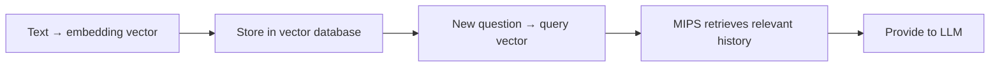

## AI Agent

An :dfn[AI agent]{#what-is-an-agent} uses an LLM as its brain and adds three modules — planning, memory and :concept[tool use]{id="tool-use"} — so it can solve complex tasks. For example, it decides what to do next, how to call external tools, reads what the tools return, and keeps going based on those results.

**==Agent ≈ LLM (brain) + Planning + Memory + Tools==**

:ink[Plain LLM: input -> output]{color="gray"}

:ink[e.g. the user asks a question -> the model generates an answer]{color="gray"}

### 1. Planning

A complex task usually cannot be completed in a single pass of reasoning.

The agent needs to :concept[break the task into several subgoals]{id="task-decomposition"} and decide the order in which to carry them out.

- **:dfn[Task Decomposition]{#task-decomposition}:** Split a complex problem into small tasks that are easier to handle.
- **Reflection:** Check whether earlier actions worked, learn from mistakes, and adjust the strategy for the next step.

#### a. Task Decomposition

Task decomposition does not have to be done entirely by the LLM itself; it can also be handed to a dedicated planning algorithm or an external tool.

**:dfn[Chain of Thought (CoT)]{#chain-of-thought}:** Follows a single reasoning path, having the model break a complex problem into a sequence of intermediate steps instead of generating the final answer directly.

:ink[**Tree of Thoughts (ToT):** Explores several candidate directions at each step, forming a tree-shaped search space. It considers multiple options at once, evaluates them, and picks a suitable direction to keep exploring.]{color="gray"}

#### b. Self-Reflection

**:dfn[ReAct]{#react}:** Combines Reasoning and Acting, letting the model switch back and forth between thinking and external actions.

**Reflexion:** Uses the experience of failures to improve the next attempt.

e.g. When an agent keeps calling the wrong tool, or keeps failing to make new progress, it should detect that something is wrong, stop the unproductive execution, and summarize why it failed. With Reflexion, the result of this reflection is written into working memory for later attempts to use.

### 2. Memory

An agent needs to store, retrieve and reuse information across multiple steps.

- **:dfn[Short-Term Memory]{#short-term-memory}:** Information in the current :concept[context]{id="llm-context"}.
- **:dfn[Long-Term Memory]{#long-term-memory}:** Usually implemented with an external database that provides persistent storage and retrieval outside the model, such as a vector database.

#### a. Why is long-term memory needed?

In scenarios with ongoing interaction, an agent often needs to draw on information accumulated in the past, such as user preferences, past decisions, task progress and analysis results.

However, an LLM does not inherently have reliable memory across sessions. The model can directly use only the information provided in the current :dfn[context]{#llm-context} (the information the model can see directly during the current inference). If past information is not provided again, the model cannot reliably access it.

One straightforward solution: append the full history to the prompt every time the model is called.

But this approach has three problems:

- **Capacity limits:** As history keeps accumulating, its size may eventually exceed the model's context window.

- **Computational cost:** Even if the model can hold the entire history, repeatedly processing large amounts of information increases token cost, inference latency and compute usage.

- **Efficiency of information use:** Large amounts of information unrelated to the current task can make it harder for the model to identify the key evidence, leading to omissions or confusion.

So an agent can introduce a :concept[long-term memory]{id="long-term-memory"} mechanism: persist the information worth keeping in a storage system outside the model's context, and retrieve it on demand according to the current task.

#### b. How can long-term memory be retrieved efficiently?

We will cover how long-term memory is implemented in detail later; here we only introduce Maximum Inner Product Search (MIPS).

For large-scale vector data, exact search can be expensive, so Approximate Nearest Neighbor (ANN) algorithms are commonly used.

### 3. Tool Use

The model's parameters cannot contain all of the latest information, and the model cannot directly perform every external operation.

So an agent extends its capabilities through :dfn[tool use]{#tool-use}, calling search engines, calculators, code execution environments, databases and other APIs.

:ink[MRKL (Modular Reasoning, Knowledge and Language): This architecture uses the LLM as a request router and lets different expert modules carry out specific tasks.]{color="gray"}

#### HuggingGPT

1. Task Planning: Understand the user's request, split it into tasks, and mark the dependencies between tasks.
2. Model Selection: Choose suitable expert models based on what each task needs.
3. Task Execution: Call the models to run the tasks and record their outputs.
4. Response Generation: Combine the execution results and answer the user.

**Task Dependencies:** Some tasks can run in parallel, while others must wait for earlier tasks to produce output. That is why complex agent systems often represent tasks as a DAG (directed acyclic graph).

## References

- [ai-agent-interview-guide: 01 Basic Concepts](https://github.com/bcefghj/ai-agent-interview-guide/blob/main/docs/01-%E9%9D%A2%E8%AF%95%E5%85%AB%E8%82%A1%E6%96%87/01-%E5%9F%BA%E7%A1%80%E6%A6%82%E5%BF%B5.md)

- [LLM Powered Autonomous Agents](https://lilianweng.github.io/posts/2023-06-23-agent/)
