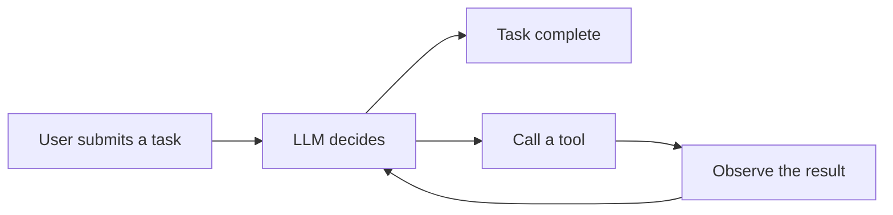
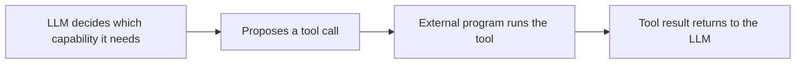
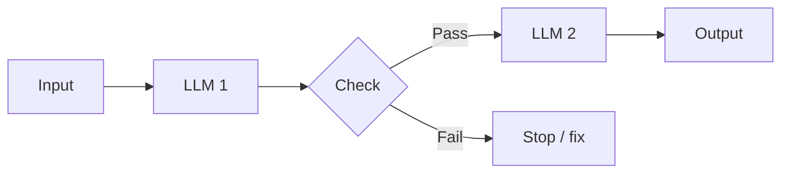
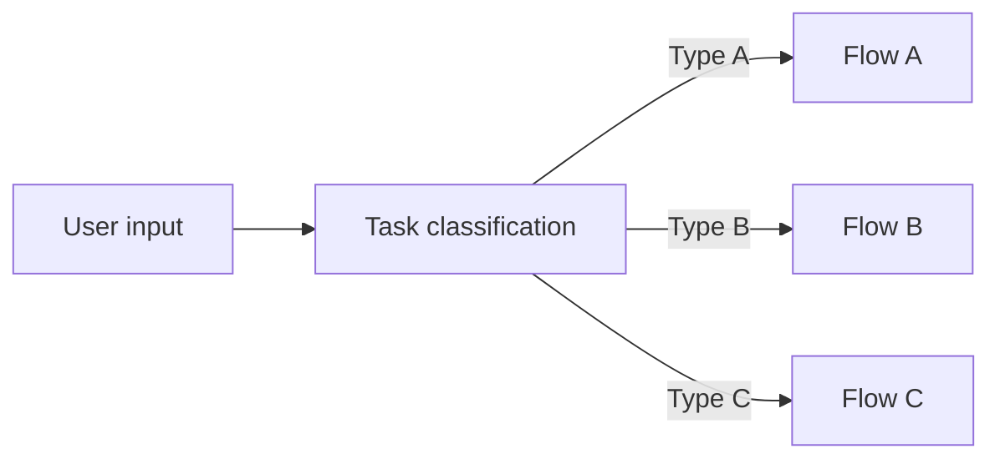
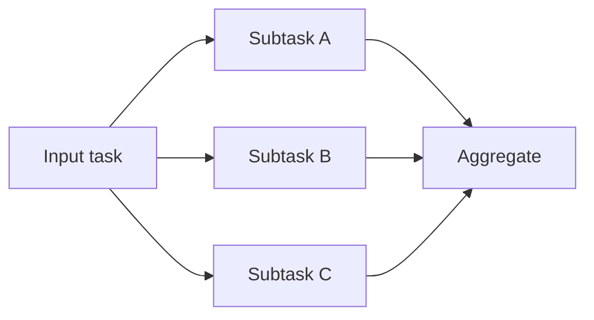
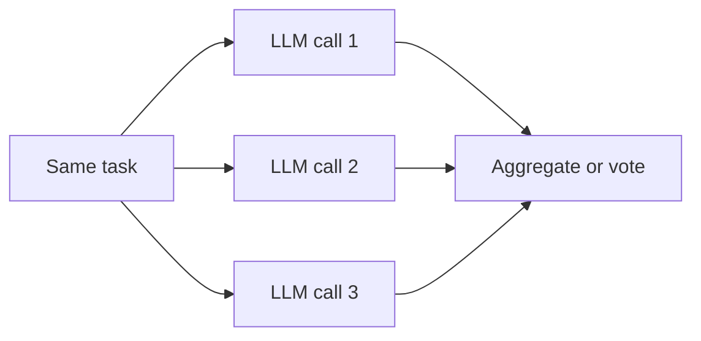
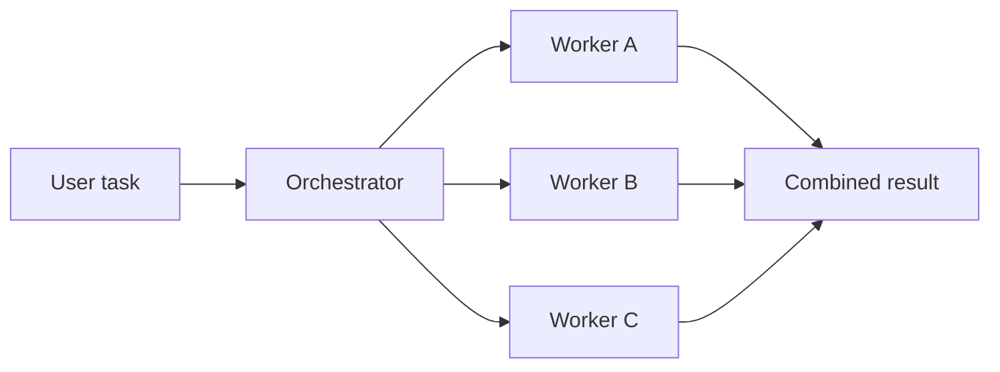
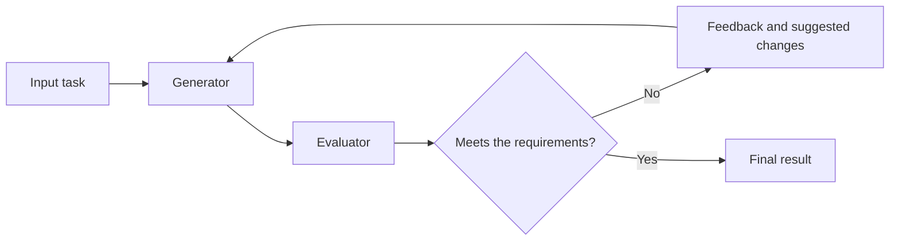
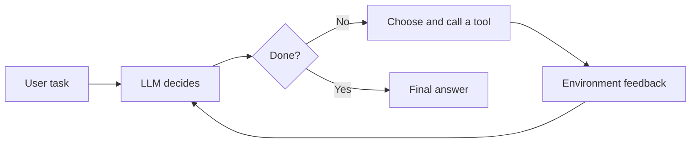

## Agentic Systems

**Workflow:** The LLM and tools carry out the task along predefined code paths.

**:concept[Agent]{id="ai-agent"}:** The LLM dynamically decides how to use tools and what to do next, based on the task and feedback from the environment.

The two are not mutually exclusive. A real system might use a fixed workflow on the outside and start an agent at one stage, letting the model complete an uncertain subtask on its own.

### 1. When should you use an agent?

An agent is not the best solution to every LLM application problem.

**==Developers should first ask: can the task be done with a simpler approach?==**

- Level 1: **A single LLM call.** Suits simple Q&A, classification, summarisation and structured information extraction

- Level 2: **LLM + Retrieval / Tools.** Adds external data and lets the model use well-defined capabilities

- Level 3: **Workflow.** Fixed multi-step tasks, branching and parallel execution

- Level 4: **Agent.** The execution steps are uncertain, and the model must keep planning and make its own decisions

### 2. When should you use a framework?

An agent framework or SDK can wrap capabilities such as LLM calls, tool execution, multi-turn conversation management and workflow orchestration, reducing the low-level code developers have to write.

But too much abstraction hides the underlying execution details and makes debugging harder: problems such as failed :concept[tool calls]{id="tool-use"} or :concept[context]{id="llm-context"} errors become hard to locate.

**Core advice:** Prefer simple, transparent implementations. Once you understand the underlying agent loop and the tool-calling mechanism, bring in a framework as real needs arise, and avoid unnecessary complexity.

### 3. Agent architecture

#### a. Building block: The Augmented LLM

:ink[**Plain LLM:** user input -> LLM -> generated answer]{color="gray"}

**Augmented LLM:** A software component with an LLM at its core that can use additional capabilities. Both workflows and agents can use this basic building block.

**==Augmented LLM = LLM + external augmentations (Retrieval, Tools, Memory, etc.)==**

| Component | Core question | Examples | Essence |
|------|----------|----|----------|
| Retrieval | Where is the information I need? | Searching the web, retrieving documents | Obtain the information the current task needs |
| Tools | What external action do I need to take? | Calling APIs, running code | Let the LLM interact with external systems and take actions |
| Memory | How is past information stored and reused? | Saving conversations, retrieving past preferences | Store and reuse past information |

:ink[**MCP (Model Context Protocol):** One optional way to implement an augmented LLM. It provides a standardised protocol that lets AI applications exchange tools, resources and other information with external systems.]{color="gray"}

- :ink[**MCP Host:** The AI application that initiates connections (such as a desktop AI assistant or an IDE); it creates and manages one or more MCP clients.]{color="gray"}
- :ink[**MCP Client:** A protocol client, created by the host, that keeps a one-to-one connection with a single MCP server.]{color="gray"}
- :ink[**MCP Server:** A program that provides capabilities such as Tools, Resources and Prompts to the application.]{color="gray"}

#### b. Workflow

==**Prompt Chaining:** Split a complex task into several LLM calls executed in sequence.==

- **Why:** If one model has to understand the requirements, design the structure, generate the content and check the quality all at once, it may drop one of them. Once the task is split up, each call only has to focus on one subproblem. You trade higher latency for more consistent execution quality.

- **When to use it:** The task divides cleanly into fixed steps with clear dependencies between them.

- **Gate:** You can add programmatic checks between steps. For example, after generating JSON, first check that it matches the schema. If it does not, stop right away or ask for regeneration, instead of passing the bad result on to later steps.

==**Routing:** First decide what type of task this is, then send it to the matching handling flow.==

- **Why:** Different kinds of questions may need different models, tools and prompts. If every task goes to the same general-purpose prompt, it can be hard to optimise for all cases at once. Routing lets you hand different tasks to specialised handling modules.

- **When to use it:**
    - The tasks fall into fairly distinct categories that can be classified reliably.
    - Model routing: send simple tasks to a cheaper small model and complex tasks to a strong model.

- **Routing vs. agent planning:** Routing usually chooses among predefined branches. Agent planning can decide dynamically what to do next, even combining several tools into a new execution path. Routing does not necessarily mean the agent is planning on its own.

==**Parallelization:** Split the task into several LLM calls that can run at the same time, then aggregate the results.==

- **(i) Sectioning:** Split the task into different subtasks, each handled by one model call. The subtasks run independently, and the results are merged at the end.

- **(ii) Voting (multiple sampling and voting):** Run the same task through several model calls and use the multiple results to make the judgement more reliable. Different calls may catch different problems, and the results are merged at the end. Multiple calls still do not guarantee a correct judgement, though.

- **How the two kinds of parallelization differ:**
    - Sectioning is about getting different pieces of work done in parallel.
    - Voting is about improving the coverage or credibility of the result through several independent attempts.

**==※ Orchestrator-Workers: A central LLM acts as the orchestrator, dynamically :concept[breaks down the task]{id="task-decomposition"}, and assigns the subtasks to several workers.==**

- **Orchestrator:**
    - Understands the complex task.
    - Breaks it into subtasks dynamically.
    - Determines dependencies and the execution strategy.
    - Assigns the tasks.
    - Integrates the results.

- **Worker:** Handles a specific subtask, such as gathering information, writing code or analysing data. Several workers may call the same underlying model, each with its own prompt, context, tool permissions and task goal. Some may not be LLMs at all, but deterministic tools or services.

- **Key difference from parallelization:**
    - In parallelization, which subtasks to run is usually fixed in advance.
    - In orchestrator-workers, the number and content of the subtasks are decided dynamically by the orchestrator based on the current input.

- **When to use it:** Complex tasks whose subtasks are dynamic but can still be delegated independently.

==**Evaluator-Optimizer:** One LLM generates a result, another LLM evaluates it, and a feedback loop keeps improving it.==

- **Generator:** Produces candidate answers.

- **Evaluator:** Judges whether the result meets specific criteria and suggests improvements. If the criteria can be computed exactly by a program, deterministic verification should usually be preferred over an LLM.

- **When to use it:**
    - You can tell fairly clearly what a better result looks like.
    - The feedback can substantially improve the next round of generation.

#### c. Agents (autonomous agents)

After an agent receives a task, it decides its next action based on the current context.

If it needs external information, it calls a tool; if further processing is needed, it keeps going.

After each action, it should update its understanding of the task state based on the actual results returned by the tools or the environment.

- **Environment feedback matters:** The model believing something is done does not mean it actually succeeded in the real environment; it has to be tested by actually running it.

- An agent must have **stopping conditions**, such as completing the task or reaching a maximum number of iterations.

- If errors occur over several consecutive rounds, they may compound and affect later decisions. So **test the agent thoroughly in a controlled environment** and set appropriate safety limits.

#### d. Combined architectures

In practice, you can combine different patterns to suit the task.

Every added pattern means more calls, more complex state transitions, higher latency and new failure paths. Whether to add complexity should therefore be decided by actual evaluation results, not just by how advanced the architecture looks.

### 4. How should you design agent tools?

- **Reduce the formatting burden:** Consider how well the model can generate structured arguments; if the format is too complex, the model is more likely to make mistakes. Rather than hoping the model always remembers complex rules, design an interface that is harder to misuse.

- To lower the chance of model errors, **settle the tool's name, parameter definitions and usage notes (purpose, edge cases, etc.)**, and actually test how the model uses the tools.

## References

- [Building Effective Agents](https://www.anthropic.com/research/building-effective-agents)
