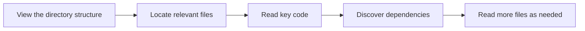
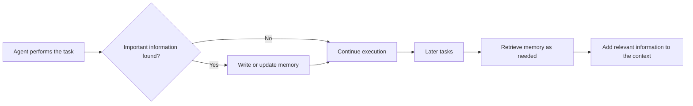
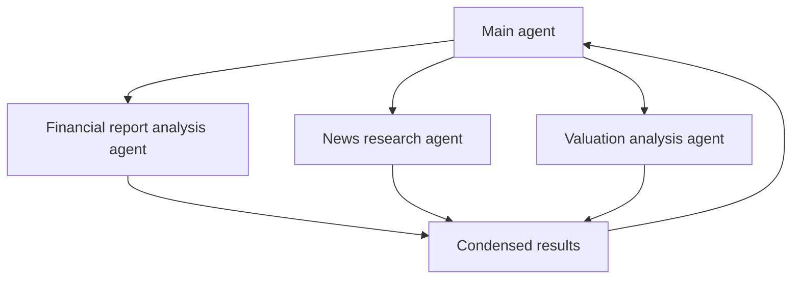

## Context Engineering

==**Context engineering:** The set of techniques for selecting, organising and maintaining :concept[context]{id="llm-context"} information during model inference, so that the model keeps producing the intended behaviour.==

If all the raw data stays in the context all the time, the model gradually gets crowded out by large amounts of information that is not necessarily relevant.

So before each inference step, an :concept[agent]{id="ai-agent"} needs to decide which information to keep, which can be dropped, and which should be fetched again when it is needed.

### 1. Prompt Engineering vs Context Engineering

Prompt engineering has become one part of context engineering.

| Dimension | Prompt Engineering | Context Engineering |
| --- | --- | --- |
| Core question | How do I write good instructions? | What should the model see right now? |
| What it manages | Mainly the prompt | The entire context |
| Typical scenarios | Single-turn Q&A, text generation | Multi-turn interaction, agent execution |
| How it changes | Usually fairly static | Changes dynamically as execution proceeds |
| Optimisation goal | Better instruction following | More reliable long-running execution |

### 2. Context Rot

**Context rot:** As the number of tokens in the context grows, the model's ability to accurately retrieve and use the information in it may gradually decline.

Even before the model reaches the hard limit of its context window, it may start missing information, losing focus and reasoning less well.

#### Why?

- **Attention is a limited resource:** The longer the context, the more complex the relationships between tokens (standard full attention has complexity $O(n^2)$), and the harder it is for the model to make effective use of all the information.

- **Uneven length distribution in training data:** Models may see more short texts during training, so they are relatively weaker at handling long-range dependencies.

- **Long-context extension techniques have limits:** Techniques such as positional encoding interpolation can extend the context window, but they cannot guarantee that the model's comprehension stays as accurate over long contexts.

**==Use as few tokens as possible, but with the highest possible information value, to raise the probability that the model produces the intended result.==**

### 3. The Anatomy of Effective Context

#### a. System Prompts

A **system prompt** is a high-priority instruction that the developer supplies when calling a large language model. It defines the model's role, task goals, behavioural rules and constraints.

In practice, the system prompt is usually passed in through the model API, rather than being concatenated with the user message into one block of plain text.

```python
messages = [
    {
        "role": "system",
        "content": "你是一名专业的股票研究助手，回答必须基于可靠数据。"
    },
    {
        "role": "user",
        "content": "分析苹果公司最近三年的盈利情况。"
    }
]

response = client.chat.completions.create(
    model="your-model",
    messages=messages
)
```

| Type | Role | Example |
| --- | --- | --- |
| System Prompt | Defines the model's overall behaviour and constraints | You are a stock research assistant |
| User Prompt | States the specific task | Analyse Apple's profitability |
| Tool Result | Supplies information returned by external tools | Revenue and profit figures from financial reports |

A system prompt should be clear and direct, and pitched at the right level of abstraction, neither overly specific nor overly abstract.

#### b. Tools: Tool Design

Tools not only let an agent take external actions; they also affect the quality of the context.

A good tool should:
- Have clear functional boundaries.
- Have clearly described parameters.
- Return concise, useful results.
- Handle errors sensibly.
- Avoid overlapping with other tools' functionality as far as possible.

In addition, the volume of data a tool returns should also be kept under control.

#### c. Examples: Example Design

**Few-shot prompting** helps the model understand the intended behaviour by providing a small number of examples.

Stuffing a large number of edge cases into the prompt is not recommended.

A better approach is to choose a few representative examples that cover different situations.

These examples should demonstrate the agent's behaviour patterns, rather than try to enumerate every possible problem.

### 4. Information Retrieval

#### a. Just-in-Time Context

Instead of loading all the information up front, keep lightweight references such as file paths, database queries and web links, and fetch the content only when the agent actually needs it.

- Progressive disclosure: The agent can obtain information by exploring step by step, rather than reading all the material at once.



- Autonomous exploration by the agent requires extra tool calls, which can add latency; without effective tools and search strategies, the agent may also waste time on irrelevant information. So stable, important information should be loaded up front, and other information fetched at runtime as needed.

:ink[**Pre-retrieval:** Traditional RAG systems usually retrieve relevant documents before the model generates an answer and place the results into the context, but this does not suit agents that carry out complex tasks.]{color="gray"}

### 5. Long-Horizon Tasks

**Long-horizon tasks** are tasks that run for a long time and may span multiple context windows, such as large code migrations, complex research or ongoing development.

| Technique | Core purpose | Suitable scenarios |
| --- | --- | --- |
| Compaction | Compress the context history | Long conversations, continuous execution |
| Structured Note-Taking | Persist key state | Iterative development, cross-session tasks |
| Sub-Agent | Isolate task context | Complex research, parallel exploration |

#### a. Compaction

Compaction means summarising the existing history when the context approaches its capacity limit, and starting a new context window from that summary.

Compaction should keep:

- Important decisions already made.
- Current task progress.
- Unresolved problems.
- Technical details needed for later execution.

Repeated messages, outdated tool outputs and similar information can usually be dropped.

The biggest risk of compaction is losing information that seems unimportant now but may be needed later. So it is advisable to first ensure recall of the key information, and then remove redundant content step by step.

#### b. Structured Note-Taking

Have the agent write important information to persistent storage outside the context window.

After the context is compacted or reset, the agent can read its notes again to restore the task state.

Structured notes can serve as one way for an agent to implement :concept[long-term memory]{id="long-term-memory"}.



#### c. Sub-Agent Architectures

For complex tasks, several specialised sub-agents can each handle different pieces of work.



Each sub-agent can use its own context window to carry out extensive searching and reasoning. But they do not need to return their full work history to the main agent; they only need to provide distilled results. This keeps the main agent's context from being filled with large amounts of intermediate data.

However, sub-agents also bring extra call costs, coordination overhead and the risk of losing information in hand-offs, so not every task needs a multi-agent architecture.

## References

- [Effective context engineering for AI agents](https://www.anthropic.com/engineering/effective-context-engineering-for-ai-agents)
- [[agent-learning-02]]
