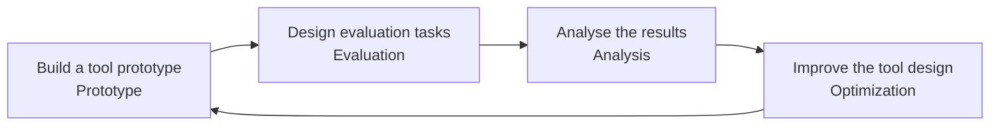
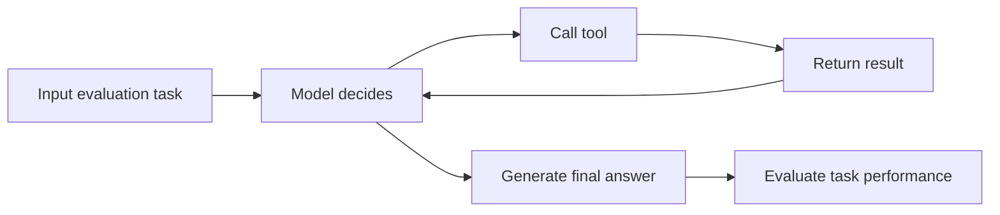

## Tools for Agents

### 1. How Agent Tools Differ from Traditional APIs

Traditional software development usually builds interfaces between deterministic systems.

```python
# Task: Look up Apple's net income for the last three years and compute the growth rate.

# The developer decides which APIs to call and in what order
company_id = get_company_id("AAPL")
reports = get_report_list(company_id, years=3)

profits = []
for report in reports:
    data = get_financial_statement(report.id)
    profits.append(data["net_income"])

growth = calculate_growth(profits)
```

An agent tool is the interface between a deterministic software system and a non-deterministic :concept[agent]{id="ai-agent"}. The agent has to work out for itself what each interface is for and how the interfaces depend on each other, so it may call them in the wrong order, pass wrong parameters, or make unnecessary repeated calls.

```python
# Task: Look up Apple's net income for the last three years and compute the growth rate.

# Tools given to the agent
get_company_financials(ticker, years)
search_company_news(ticker, query)
calculate_growth(values)

# The agent decides the steps itself
1. Call get_company_financials to get three years of net income
2. Call calculate_growth and produce the final answer

# If the user asks a follow-up question, the agent can decide its next call path on its own
```

| Dimension | Traditional program + API | Agent + tool |
| --- | --- | --- |
| Who decides the call flow? | Code written by the developer | The LLM, dynamically |
| How are interfaces designed? | Usually around low-level resources and operations | Tend to be task-oriented |
| When requirements change | The business logic may need to be modified | The agent can combine existing tools on its own |
| Is execution fixed? | Usually follows preset logic | May take different paths |

### 2. How Do You Build Effective Tools?



- Build a prototype: start from a minimal working prototype of the tools.

- Run an evaluation: can the model, on real tasks, choose the right tools, construct the parameters, and reach the goal through a series of calls?
    - Build realistic tasks
    - Run the tasks through an agent loop: create a separate run for each evaluation task, and save the final answer, the tool call records, the tool results, error messages, the execution trace and so on
    - Collect metrics: Task Success Rate (whether the task ultimately succeeds), Tool Call Count (number of tool calls), Token Consumption (number of tokens used), Execution Time (time spent on tools and on the whole task), Tool Error Rate (how tool calls fail)



- Analyse the results

| Observed behaviour | Likely cause |
| --- | --- |
| Calls the same tool repeatedly | The result lacks information, or the query scope is unreasonable |
| Often passes wrong parameters | Parameter names or the schema are unclear |
| Picks the wrong tool | Tools overlap in function, or descriptions are ambiguous |
| Answers wrongly even after correct calls | The tool result is hard to understand |
| Many tokens spent on tool results | The returned content is too verbose |

- Use agents such as Claude Code to improve the tools

#### Principles for Effective Tool Design

- **Design tools around the agent's actual tasks rather than wrapping low-level APIs one by one as tools.** For example, wrap several financial-report query APIs into get_company_financials(), which cuts the number of call steps and the chances of error while keeping the necessary flexibility.

- **Use clear namespaces to show which service and function each tool belongs to, lowering the chance that the agent picks the wrong tool.** For example, use github_search_issues() and slack_search_messages() instead of a vague search().

- **Tools should return semantically clear information that the model can easily understand**, rather than only identifiers with no meaning such as UUIDs. A response_format parameter can offer two return modes, concise and detailed, to balance readability against what later calls need.

- **Use pagination, range selection, filtering and truncation to cut redundant information from tool results,** which reduces :concept[context]{id="llm-context"} consumption. Truncation notices and error messages should also include actionable suggestions that help the agent adjust its parameters or correct its calls.

- **The tool description and tool schema should state clearly what the tool is for, when to use it, the parameter constraints and the structure of what it returns, so the model can choose and call it correctly.** For example, use search_financial_reports(ticker, fiscal_year) instead of an ambiguous search(query).

## References

- [Writing effective tools for agents — with agents](https://www.anthropic.com/engineering/writing-tools-for-agents)
- [[agent-learning-03]]
