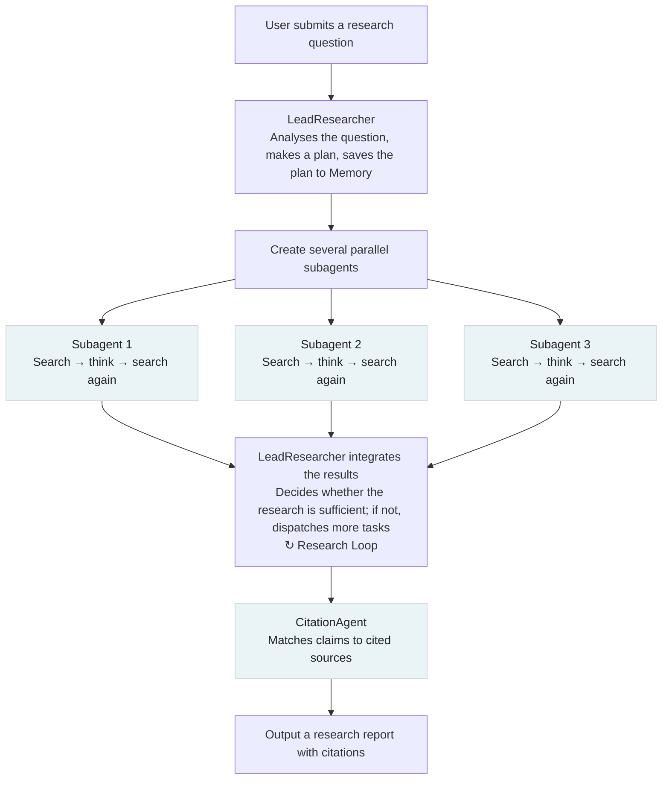

## Multi-Agent Systems

### 1. Why Multi-Agent?

A single :concept[agent]{id="ai-agent"} has two main limitations:
- **Limited :concept[context]{id="llm-context"} capacity:** Large volumes of search results fill up the context window and make information harder to manage.
- **Slow serial execution:** Several independent directions have to be investigated one after another, so research can take a long time.

==**Multi-Agent:** uses **several agents working together** to split a complex research task into subtasks that can run in parallel.==

Each subagent has its own context window. It can explore a large amount of information on its own, then compress the most important parts and return them to the lead agent.

A subagent therefore plays two roles at once:
1. **Independent researcher:** responsible for one specific research direction.
2. **Information filter:** selects what matters and reduces the context load on the lead agent.

Although a multi-agent system can deliver a significant capability gain over a single agent, it also uses more tokens. It is therefore best suited to complex, high-value tasks that can be split up and run in parallel and that require extensive information retrieval.

### 2. Architecture of the Multi-Agent Research System

| Component | Responsibilities |
| --- | --- |
| LeadResearcher | Planning, splitting the task, invoking subagents, integrating results |
| Subagent | Searching independently, analysing sources, returning findings |
| CitationAgent | Checking the claims in the report and locating the matching citations |

- First, the lead agent saves the research plan to external memory. Persisting the key plan keeps the research direction from being lost when the context is truncated.
- Second, a subagent does not just call a search API once. It analyses the search results, identifies information gaps and keeps searching.
- Third, once the research is finished, the system hands off to the CitationAgent, which locates the specific sources that support the report's claims, instead of relying on the research agents to handle citations in passing while they generate text.

### 3. Making Multiple Agents Work Together Effectively

#### a. Observe how the agents actually execute.

Reading the prompt alone rarely tells you how an agent will actually behave.

#### b. Define each subagent's task clearly.

| Element | Description |
| --- | --- |
| Objective | What exactly to investigate |
| Output Format | What kind of result to return |
| Tools / Sources | Which tools and information sources to use |
| Boundaries | The scope of the task and what not to investigate |

#### c. Allocate resources according to task complexity.

| Task complexity | Number of agents | Tool call budget |
| --- | --- | --- |
| Simple fact lookup | 1 | 3–10 calls |
| Direct comparison | 2–4 subagents | 10–15 calls each |
| Complex research | Possibly more than 10 subagents | Allocated by responsibility |

#### d. Choose tools correctly.

As more tools are connected through :concept[MCP]{id="mcp"}, an agent is more likely to pick the wrong tool when tool descriptions are unclear.

- First examine the available tools and what they are for.
- Match tools to the user's goal.
- Prefer specialised tools designed for the task.
- Keep tool descriptions clear and avoid overlapping responsibilities.

A dedicated tool-testing agent can try the tools automatically, find errors and rewrite the tool descriptions.

#### e. Explore broadly first, then dig deeper

Don't start a piece of research with very narrow search queries.

The right strategy is to first get a picture of how the information is distributed, then narrow the question step by step.

#### f. Use thinking for dynamic planning

An agent should not fix all its search steps up front. It should revise the plan dynamically based on intermediate results.

#### g. Two levels of parallelism

- The lead agent launches several subagents at the same time.
- Each subagent can in turn call several tools in parallel.

#### h. Prefer heuristics over rigid procedures

### 4. Evaluating Multi-Agent Systems

#### a. Focus on whether the final result is correct and whether the process used to complete the task is reasonable.

#### b. Start with small-scale tests

#### c. LLM-as-Judge

Use an LLM as the judge, focusing on five dimensions.

| Dimension | Evaluation question |
| --- | --- |
| Factual Accuracy | Are the facts correct? |
| Citation Accuracy | Do the citations actually support the corresponding claims? |
| Completeness | Does it cover every aspect the user asked for? |
| Source Quality | Does it prefer reliable primary sources? |
| Tool Efficiency | Does it complete the task at a reasonable tool call cost? |

#### d. Add human evaluation where needed

### 5. Production Reliability

#### a. Support failure recovery

- **Checkpoint:** Save the execution state regularly.
- **Retry:** Retry failures that are suitable for retrying.
- **Resume:** Resume execution from the point of failure wherever possible.
- **Adaptive Recovery:** Tell the model about tool failures so it can adjust its execution strategy.

#### b. Fully trace execution paths and error causes, and analyse high-level agent behaviour patterns

#### c. Rainbow Deployment

Run the old and new versions side by side for a while, then shift traffic over gradually, so tasks that are already running are not disrupted.

#### d. Trade-offs between synchronous and asynchronous execution

## References

- [How we built our multi-agent research system](https://www.anthropic.com/engineering/multi-agent-research-system)
- [[agent-learning-04]]
