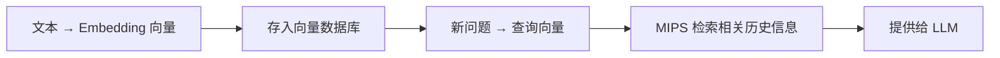

## AI Agent

:dfn[AI Agent]{#what-is-an-agent} 让 LLM 充当智能体的大脑，再通过规划、记忆和工具使用三个模块，使其具备解决复杂任务的能力。例如决定下一步做什么、如何调用外部工具、读取工具返回结果，并且根据结果继续执行。

**==Agent ≈ LLM（大脑） + Planning（规划）+ Memory（记忆）+ Tools（工具）==**

:ink[普通LLM: 输入 -> 输出]{color="gray"}

:ink[e.g. 用户提出问题 -> 模型生成答案]{color="gray"}

### 1. Planning

复杂任务通常无法通过一次推理完成。

Agent 需要把任务分解成多个子目标，并决定执行顺序。

- **:dfn[Task Decomposition（任务分解）]{#task-decomposition}:** 把复杂问题拆分为容易处理的小任务。
- **Reflection（反思）:** 检查此前的行动是否有效，从错误中吸取经验，调整下一步策略。

#### a. 任务分解（Task Decomposition）

任务分解不一定完全由 LLM 自己完成，也可以交给专门的规划算法或外部工具。

**:dfn[Chain of Thought（CoT，思维链）]{#chain-of-thought}:** 沿着一条推理路径前进，让模型把复杂问题拆解为连续的中间步骤，而不是直接生成最终答案。

:ink[**Tree of Thoughts（ToT，思维树）:** 在每一步探索多个候选方向，形成树状搜索空间。同时考虑多种方案，评价后选择合适的方向继续探索。]{color="gray"}

#### b. 自我反思（Self-Reflection）

**:dfn[ReAct]{#react}:** 将 Reasoning（推理）与 Acting（行动）结合起来，允许模型在思考与外部操作之间反复切换。

**Reflexion:** 利用失败经验改善下一次尝试。

e.g. 当 Agent 连续调用错误的工具 / 一直无法取得新进展，应当检测到存在问题，停止无效执行，并总结失败原因。通过 Reflexion 将反思结果写入工作记忆，供后续尝试使用。

### 2. Memory

Agent 需要在多个步骤之间保存、检索和复用信息。

- **:dfn[短期记忆（Short-Term Memory）]{#short-term-memory}:** 当前上下文中的信息。
- **:dfn[长期记忆（Long-Term Memory）]{#long-term-memory}:** 通常通过外部数据库实现外部持久化存储与检索，例如向量数据库。

#### a. 为什么需要长期记忆？

在持续交互的场景中，Agent 往往需要利用过去积累的信息，例如用户偏好、历史决策、任务进度和分析结果。

然而，LLM 本身并不天然具备可靠的跨会话记忆能力。模型只能直接利用当前:dfn[上下文]{#llm-context}（Context，模型当前这一次推理能够直接看到的信息）中提供的信息。如果过去的信息没有被重新提供，模型就无法可靠地访问它们。

一种直接的解决方案是: 在每次调用模型时，都将完整历史记录附加到 Prompt 中。

但这种方案存在三个问题: 

- **容量限制:** 随着历史信息不断积累，其规模最终可能超过模型的上下文窗口。

- **计算成本:** 即使模型能够容纳全部历史，反复处理大量信息也会增加 Token 成本、推理延迟和计算资源消耗。

- **信息利用效率:** 大量与当前任务无关的信息可能干扰模型识别关键证据，导致遗漏或混淆。

因此，Agent 可以引入长期记忆机制，将需要保留的信息持久化到模型上下文之外的存储系统中，并根据当前任务按需检索。

#### b. 如何高效检索长期记忆？

未来我们会详细介绍长期记忆的实现，这里我们只介绍最大内积搜索（MIPS）。

对于大规模向量数据，精确搜索可能很昂贵，因此常使用 Approximate Nearest Neighbor（ANN，近似最近邻搜索）算法。

### 3. Tool Use

模型的参数无法包含所有最新信息，也无法直接完成所有外部操作。

因此，Agent 需要通过:dfn[工具使用]{#tool-use}，调用搜索引擎、计算器、代码执行环境、数据库以及其他 API 来扩展自身能力。

:ink[MRKL（Modular Reasoning, Knowledge and Language）: 这种架构把 LLM 作为请求分发器，让不同的专家模块执行特定任务。]{color="gray"}

#### HuggingGPT

1. Task Planning: 理解用户需求，拆分任务，并标记任务依赖。
2. Model Selection: 根据任务需求选择合适的专家模型。
3. Task Execution: 调用模型执行任务，并记录输出。
4. Response Generation: 整合执行结果，回答用户。

**任务依赖关系（Task Dependencies）:** 有些任务可以并行执行，有些任务必须等待前面的任务产生输出。所以复杂 Agent 系统经常需要 DAG（有向无环图）这样的任务表示方式。

## 参考资料

- [ai-agent-interview-guide: 01-基础概念](https://github.com/bcefghj/ai-agent-interview-guide/blob/main/docs/01-%E9%9D%A2%E8%AF%95%E5%85%AB%E8%82%A1%E6%96%87/01-%E5%9F%BA%E7%A1%80%E6%A6%82%E5%BF%B5.md)

- [LLM Powered Autonomous Agents](https://lilianweng.github.io/posts/2023-06-23-agent/)