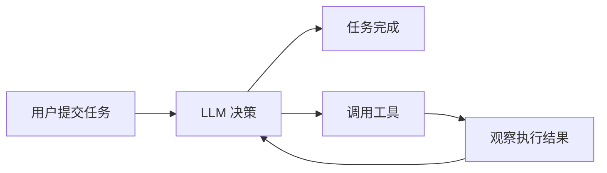
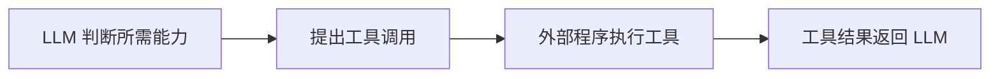
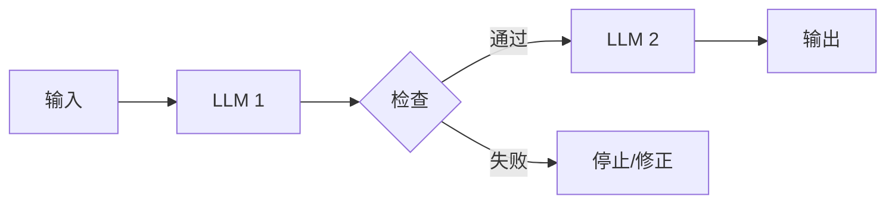
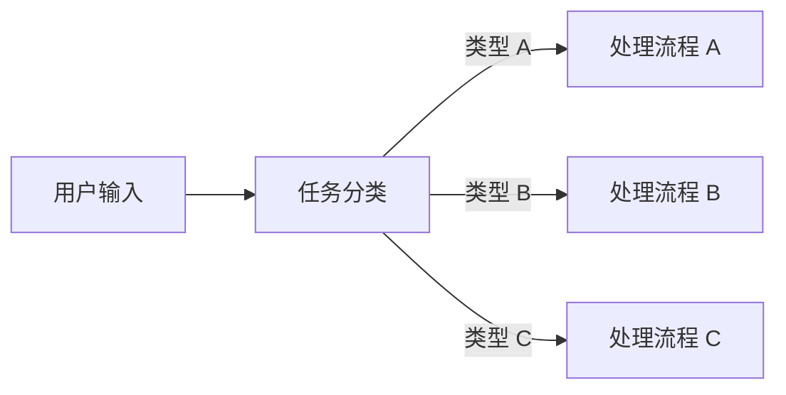
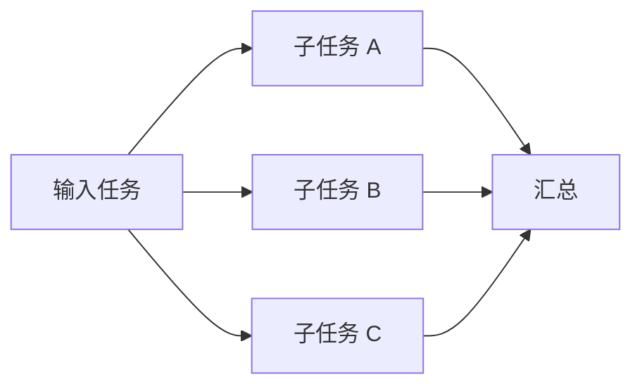
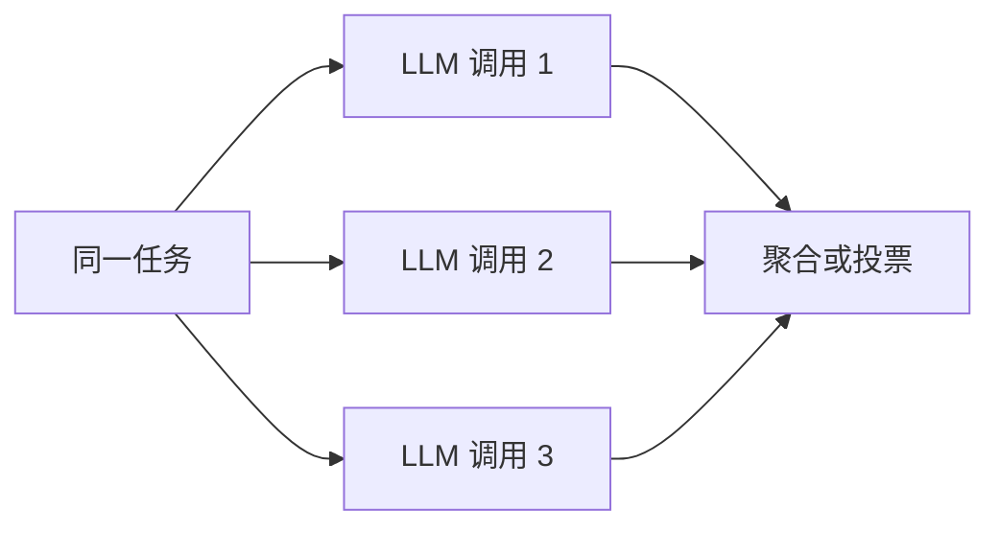
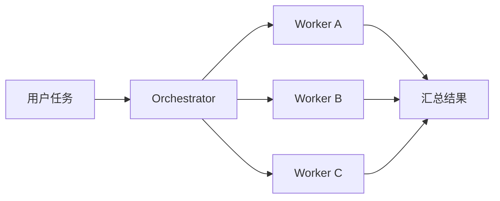
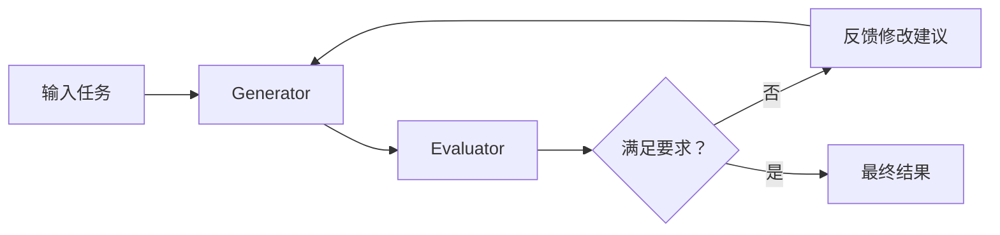
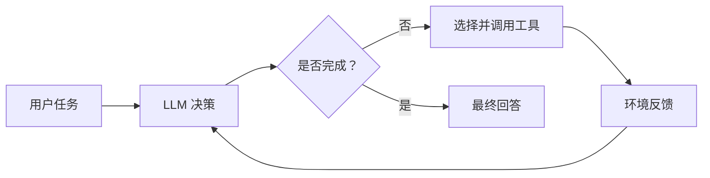

## Agentic Systems（智能体式系统）

**Workflow:** LLM 和工具按照预先设计的程序路径执行任务。

**:concept[Agent]{id="ai-agent"}:** 由 LLM 根据任务和环境反馈，动态决定如何使用工具、如何执行下一步。

二者并不是完全互斥的。实际系统可能在外层使用固定 Workflow，在某个阶段启动 Agent，让模型自主完成一个不确定的子任务。

### 1. 什么时候应该使用 Agent？

Agent 不是解决所有 LLM 应用问题的最佳方案。

**==开发者应该先评估: 是否可以用更简单的方法完成任务？==**

- Level 1: **单次 LLM 调用。** 适合简单问答、分类、摘要、结构化信息提取

- Level 2: **LLM + Retrieval / Tools。** 补充外部数据，让模型使用明确的能力

- Level 3: **Workflow。** 固定的多步骤任务、分支处理、并行执行

- Level 4: **Agent。** 执行步骤不确定，需要模型持续规划并自主决策

### 2. 什么时候应该使用框架？

Agent Framework / SDK 可以封装 LLM 调用、工具执行、多轮对话管理和工作流编排等能力，可以减少开发者需要编写的底层代码。

但过度封装会隐藏底层执行细节，增加调试难度，难以定位如:concept[工具调用]{id="tool-use"}失败、:concept[上下文]{id="llm-context"}错误等问题。

**核心建议:** 优先使用简单、透明的实现，理解底层 Agent Loop 和工具调用机制后，再根据实际需求引入框架，避免不必要的复杂性。

### 3. Agent 架构

#### a. 基础构建模块（Building Block）: The Augmented LLM（增强型 LLM）

:ink[**普通 LLM:** 用户输入 -> LLM -> 生成回答]{color="gray"}

**Augmented LLM:** 一个以 LLM 为核心、能够使用额外能力的软件组件，Workflow 和 Agent 都可以使用这个基础构建单元。

**==Augmented LLM = LLM + 外部增强能力（Retrieval、Tools、Memory 等）==**

| 组件 | 核心问题 | 举例 | 核心 |
|------|----------|----|----------|
| Retrieval | 我需要的信息在哪里？ | 搜索网页、检索文档 | 取得当前任务需要的信息 |
| Tools | 我需要执行什么外部操作？ | 调用 API、运行代码 | 让 LLM 能够与外部系统交互并执行操作 |
| Memory | 过去的信息如何保存和复用？ | 保存对话、检索历史偏好 | 保存和复用过去的信息 |

:ink[**MCP（Model Context Protocol）:** 实现 Augmented LLM 的一种可选方式，提供了一套标准化协议，让 AI 应用能够与外部系统交换工具、资源等信息。]{color="gray"}

- :ink[**MCP Host:** 发起连接的 AI 应用本身（如桌面 AI 助手、IDE），负责创建和管理一个或多个 MCP Client。]{color="gray"}
- :ink[**MCP Client:** 由 Host 创建、与某个 MCP Server 保持一对一连接的协议客户端。]{color="gray"}
- :ink[**MCP Server:** 向应用提供 Tools、Resources、Prompts 等能力的程序。]{color="gray"}

#### b. Workflow

:ink[**Prompt Chaining（提示词链）:** 将复杂任务拆分成顺序执行的多个 LLM 调用。]{color="gray"}

- **Why:** 如果一个模型需要同时完成理解需求、设计结构、生成内容和检查质量，可能顾此失彼。将任务拆解后，每次调用只需要关注其中一个子问题。用更高延迟换取更稳定的执行质量。

- **适用场景:** 任务可以清晰划分为多个固定步骤，且步骤之间存在明确依赖关系。

- **Gate（检查节点）:** 可以在步骤之间加入程序化检查，例如生成 JSON 后，先检查它是否符合 Schema。如果不符合，直接中止或者要求重新生成，不需要把错误结果继续传递到后面的步骤。

:ink[**Routing（路由）:** 先判断任务属于哪种类型，再分配到相应的处理流程。]{color="gray"}

- **Why:** 不同类型的问题可能需要不同的模型、工具和 Prompt。如果所有任务都交给同一个通用 Prompt，可能难以同时优化所有场景。通过 Routing，可以将不同任务交给专门的处理模块。

- **适用场景:** 
    - 任务有比较明确的类别，并且可以可靠地进行分类。
    - 模型路由: 简单任务交给成本较低的小模型；复杂任务交给强模型。

- **Routing 与 Agent Planning 的区别:** Routing 通常是在预定义分支中进行选择。Agent Planning 则可以动态决定后续需要执行什么，甚至组合多个工具形成新的执行路径。Routing 不一定意味着 Agent 自主规划。

:ink[**Parallelization（并行化）:** 将任务拆分成多个可以同时执行的 LLM 调用，再汇总结果。]{color="gray"}

- **(i) Sectioning（任务分割）:** 将任务拆分为不同子任务，每个模型调用负责一个部分。各个任务可以独立运行，最后合并结果。

- **(ii) Voting（多次采样与投票）:** 对于同一个任务，运行多次模型调用，利用多个结果提高判断的可靠性。不同模型调用可能发现不同问题，最后合并结果。不过多次调用并不保证判断一定正确。

- **两种并行化的区别:** 
    - Sectioning 关注的是把不同工作并行完成。
    - Voting 关注的是通过多次独立尝试，提高结果的覆盖率或可信度。

:ink[**※ Orchestrator-Workers（协调者—工作者模式）: 用一个中心 LLM 作为协调者，动态:concept[分解任务]{id="task-decomposition"}，并将子任务分配给多个 Worker。**]{color="gray"}

- **Orchestrator（协调者）:** 
    - 理解复杂任务。
    - 动态拆解子任务。
    - 确定依赖关系与执行策略。
    - 分配任务。
    - 整合执行结果。

- **Worker（工作者）:** 负责具体子任务，例如检索资料、编写代码、分析数据。不过多个 Worker 可能调用同一个底层模型，只是各自具有不同的 Prompt、上下文、工具权限和任务目标。甚至有些可以不是 LLM，而是确定性的工具或服务。

- **与 Parallelization 的关键区别:** 
    - 在 Parallelization 中，需要执行哪些子任务，通常已经提前确定。
    - 在 Orchestrator-Workers 中，子任务的数量和内容由 Orchestrator 根据当前输入动态决定。

- **适用场景:** 适合复杂任务具有动态子任务、但子任务又可以独立委托的情况。

:ink[**Evaluator-Optimizer（评估者—优化者模式）:** 使用一个 LLM 生成结果，另一个 LLM 进行评价，并通过反馈循环持续改进。]{color="gray"}

- **Generator（生成器）:** 负责生成候选答案。

- **Evaluator（评估器）:** 负责评价结果是否满足特定标准，并提供改进意见。如果评价标准可以被程序精确计算，通常应该优先使用确定性验证，而不是用 LLM。

- **适用场景:** 
    - 能够比较明确地判断什么是更好的结果。
    - 反馈能够实质性地改善下一轮生成。

#### c. Agents（自主智能体）

Agent 接收到任务后，根据当前上下文决定下一步行动。

如果需要外部信息，调用工具；如果需要进一步处理，就继续执行。

每次行动后，都应该根据工具或环境返回的实际结果，更新对任务状态的认识。

- **环境反馈很重要:** 模型自己认为某件事情完成了，不代表它在真实环境中已经成功，需要实际执行测试。

- Agent 必须有**终止条件**，例如完成任务或达到最大迭代次数。

- 如果连续几轮执行发生错误，这些错误可能不断累积，并影响后续决策。因此，**应在受控环境中充分测试 Agent**，并设置适当的安全限制。

#### d. 组合架构

实际开发时，可以根据任务需要组合不同模式。

每增加一个模式，都意味着更多调用、更复杂的状态流转、更高的延迟以及新的失败路径。因此，是否增加复杂度应由实际评测结果决定，而不是仅凭架构是否先进。

### 4. 如何设计 Agent 工具？

- **减少格式负担:** 需要考虑模型生成结构化参数的能力，如果格式过于复杂，模型更容易出错。与其希望模型永远记住复杂规则，不如设计一个更不容易被错误使用的接口。

- 为了降低模型出错的可能性，需要 **确认好工具的名称、参数定义和使用说明（用途、边界条件等）**，并实际测试模型如何使用这些工具。

## 参考资料

- [Building Effective Agents](https://www.anthropic.com/research/building-effective-agents)
