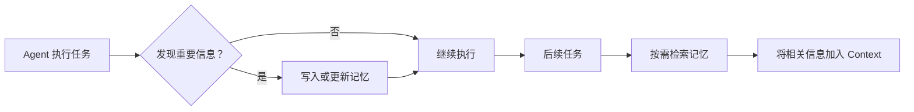
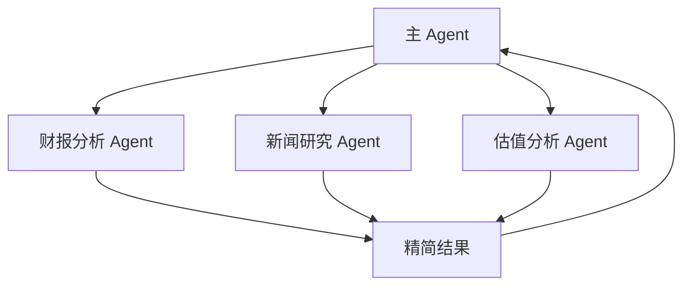

## Context Engineering（上下文工程）

==**Context Engineering（上下文工程）:** 在模型推理过程中，选择、组织、维护:concept[上下文]{id="llm-context"}信息，使模型能够持续产生预期行为的一系列技术。==

如果将所有原始数据一直保留在上下文中，模型会逐渐被大量不一定相关的信息占据。

因此，:concept[Agent]{id="ai-agent"} 需要在每次推理前决定: 哪些信息需要保留，哪些可以删除，哪些应该在需要时重新获取。

### 1. Prompt Engineering VS Context Engineering

Prompt Engineering 已成为 Context Engineering 的组成部分。

| 对比维度 | Prompt Engineering | Context Engineering |
| --- | --- | --- |
| 核心问题 | 如何写好指令？ | 模型此刻应该看到什么？ |
| 管理对象 | 主要是提示词 | 整个上下文 |
| 典型场景 | 单次问答、文本生成 | 多轮交互、Agent 执行 |
| 更新方式 | 通常相对静态 | 随执行过程动态变化 |
| 优化目标 | 提升指令遵循效果 | 提升长期执行的可靠性 |

### 2. Context Rot（上下文退化）

**Context Rot:** 随着上下文中的 Token 数量增加，模型准确检索和利用其中信息的能力可能逐渐下降。

即使模型尚未达到上下文窗口的硬性上限，也可能出现信息遗漏、注意力分散和推理质量下降等问题。

#### Why？

- **注意力资源有限:** 上下文越长，Token 之间的关联越复杂（标准全注意力复杂度为 $O(n^2)$），模型越难有效利用所有信息。

- **训练数据长度分布不均:** 模型训练时可能接触更多短文本，因此处理长距离信息依赖的能力相对较弱。

- **长上下文扩展技术存在局限:** 位置编码插值等技术虽然能扩展上下文窗口，但无法保证模型在长上下文中的理解精度不下降。

**==使用尽可能少、但信息价值尽可能高的 Token，提高模型产生预期结果的概率。==**

### 3. The Anatomy of Effective Context（上下文组成）

#### a. System Prompts: 系统提示词

**System Prompt** 是开发者在调用大语言模型时提供的高优先级指令，用于定义模型的角色、任务目标、行为规则和约束条件。

在实际开发中，System Prompt 通常通过模型 API 传入，而不是与用户消息直接拼接成一段普通文本。

```python
messages = [
    {
        "role": "system",
        "content": "你是一名专业的股票研究助手，回答必须基于可靠数据。"
    },
    {
        "role": "user",
        "content": "分析苹果公司最近三年的盈利情况。"
    }
]

response = client.chat.completions.create(
    model="your-model",
    messages=messages
)
```

| 类型 | 作用 | 示例 |
| --- | --- | --- |
| System Prompt | 定义模型的整体行为与约束 | 你是一名股票研究助手 |
| User Prompt | 提出具体任务 | 分析苹果公司的盈利情况 |
| Tool Result | 提供外部工具返回的信息 | 财报中的营收、利润数据 |

System Prompt 应该清晰、直接，并处于合适的抽象层次。避免过度具体或者过度抽象。

#### b. Tools: 工具设计

工具不仅让 Agent 能够执行外部操作，也会影响上下文的质量。

一个好的工具应该满足: 
- 功能边界清晰。
- 参数描述明确。
- 返回结果简洁且有用。
- 具备合理的错误处理。
- 尽量避免与其他工具的功能重叠。

此外，工具返回的数据也应该控制体积。

#### c. Examples: 示例设计

**Few-shot Prompting** 是通过提供少量示例，帮助模型理解预期行为的方法。

不建议将大量边界案例全部堆入提示词。

更好的方式是选择少量具有代表性、覆盖不同情况的示例。

这些示例应该展示 Agent 的行为模式，而不是试图穷举所有可能的问题。

### 4. 信息检索

#### a. Just-in-Time Context（即时上下文获取）

不必提前加载全部信息，而是保留文件路径、数据库查询、网页链接等轻量引用，在 Agent 真正需要时再获取内容。

- 渐进式信息披露（Progressive Disclosure）: Agent 可以通过逐步探索获取信息，而不是一次性读取所有资料。


- Agent 自主探索需要额外的工具调用，可能增加延迟；如果缺乏有效的工具和搜索策略，也可能在无关信息上浪费时间。因此，应当预先加载稳定且重要的信息，在运行时按需获取其他信息。

:ink[**预先检索:** 传统的 RAG 系统通常在模型生成回答之前，先检索相关文档，再将检索结果放入上下文，但这并不利于执行复杂任务的 agent。]{color="gray"}

### 5. 长周期任务（Long-Horizon Tasks）

**长周期任务（Long-Horizon Tasks）** 是指执行时间较长、可能跨越多个上下文窗口的任务，例如大型代码迁移、复杂研究或持续开发。

| 技术 | 核心作用 | 适合场景 |
| --- | --- | --- |
| Compaction | 压缩历史上下文 | 长时间对话、连续执行 |
| Structured Note-Taking | 持久化关键状态 | 迭代开发、跨会话任务 |
| Sub-Agent | 隔离任务上下文 | 复杂研究、并行探索 |

#### a. Compaction: 上下文压缩

**Compaction** 是指在上下文接近容量限制时，对已有历史进行总结，并使用总结结果启动新的上下文窗口。

压缩时应该保留: 

- 已经做出的重要决策。
- 当前任务进度。
- 尚未解决的问题。
- 后续执行需要的技术细节。

而重复消息、过时的工具输出等信息通常可以删除。

压缩最大的风险是丢失那些当前看起来不重要、但后续可能需要的信息。因此，建议先保证关键信息的召回率，再逐步删除冗余内容。

#### b. Structured Note-Taking: 结构化笔记

让 Agent 将重要信息写入上下文窗口之外的持久化存储。

当上下文被压缩或重置后，Agent 可以重新读取笔记，恢复任务状态。

结构化笔记可以作为 Agent 实现:concept[长期记忆]{id="long-term-memory"}的一种方式。



#### c. Sub-Agent Architectures: 子 Agent 架构

对于复杂任务，可以让多个专门的 Sub-Agent 分别处理不同工作。



每个 Sub-Agent 都可以使用独立的上下文窗口，完成大量搜索和推理。但它们不需要将全部工作历史返回主 Agent，只需要提供经过提炼的结果。这样可以避免主 Agent 的上下文被大量中间数据占据。

不过，Sub-Agent 也有额外的调用成本、协调开销和信息传递风险，并不是所有任务都需要使用多 Agent 架构。

## 参考资料

- [Effective context engineering for AI agents](https://www.anthropic.com/engineering/effective-context-engineering-for-ai-agents)
- [[agent-learning-02]]
