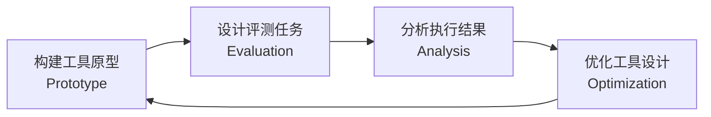
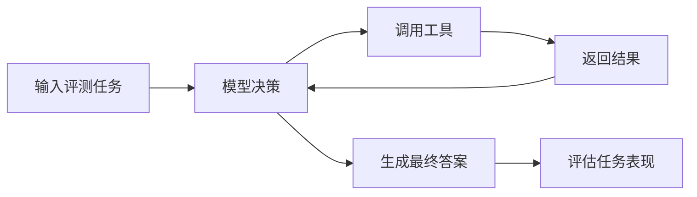

## Tools for Agents（面向 Agent 的工具）

### 1. Agent Tools 和传统 API 的区别

传统软件开发通常是在确定性系统（Deterministic Systems）之间建立接口。

```python
# Task: 查询苹果公司最近三年的净利润，并计算增长率。

# 开发者决定调用哪些 API、按什么顺序调用
company_id = get_company_id("AAPL")
reports = get_report_list(company_id, years=3)

profits = []
for report in reports:
    data = get_financial_statement(report.id)
    profits.append(data["net_income"])

growth = calculate_growth(profits)
```

Agent Tool 是确定性软件系统与非确定性 :concept[Agent]{id="ai-agent"} 之间的接口。Agent 必须自行理解每个接口的用途和依赖关系，可能出现调用顺序错误、参数错误或不必要的重复调用。

```python
# Task: 查询苹果公司最近三年的净利润，并计算增长率。

# 给 agent 提供工具
get_company_financials(ticker, years)
search_company_news(ticker, query)
calculate_growth(values)

# Agent 自己决定执行步骤
1. 调用 get_company_financials, 获取三年净利润
2. 调用 calculate_growth, 生成最终答案

# 若用户进一步追问，Agent 可以自主决定接下来的调用路径
```

| 对比维度 | 传统程序 + API | Agent + Tool |
| --- | --- | --- |
| 谁决定调用流程？ | 开发者编写的代码 | LLM 动态决策 |
| 接口如何设计？ | 通常面向底层资源和操作 | 倾向面向任务 |
| 需求变化时 | 可能需要修改业务逻辑 | 可以自主组合已有工具 |
| 执行是否固定？ | 通常按预设逻辑 | 可能采取不同路径 |

### 2. 如何开发高效工具？



- **构建原型:** 从最小可用的工具原型开始。

- **运行评测:** 模型能否在真实任务中，正确选择工具、构造参数，并通过一系列调用完成目标。
    - **构建真实任务**
    - **通过 Agent Loop 执行任务:** 为每个评测任务创建独立执行过程，保存最终答案、工具调用记录、工具返回结果、错误信息和执行轨迹等
    - **收集指标:** Task Success Rate（任务最终是否成功）、Tool Call Count（工具调用次数）、Token Consumption（Token 消耗量）、Execution Time（工具及任务执行耗时）、Tool Error Rate（工具调用错误情况）



- **分析结果**

| 观察到的现象 | 可能原因 |
| --- | --- |
| 反复调用同一个工具 | 返回信息不足，或查询范围不合理 |
| 经常传入错误参数 | 参数命名或 Schema 不清晰 |
| 选择了错误的工具 | 工具功能重叠，描述有歧义 |
| 正确调用后仍回答错误 | 工具返回结果难以理解 |
| 大量 Token 消耗在工具结果上 | 返回内容过于冗长 |

- **使用 Claude Code 等 Agent 优化工具**

#### 高效工具设计原则

- **工具应围绕 Agent 的实际任务设计，而不是将底层 API 逐个封装成 Tool。** 例如，将多个财报查询 API 封装为 get_company_financials()，减少调用步骤和出错机会，同时保留必要的灵活性。

- **使用清晰的命名空间区分工具所属的服务和功能，降低 Agent 选错工具的概率。** 例如，使用 github_search_issues() 和 slack_search_messages()，而不是模糊的 search()。

- **工具应返回语义清晰、便于模型理解的信息** ，避免只有 UUID 等缺乏语义的标识符。可以通过 response_format 提供 concise（简洁）和 detailed（详细）两种返回模式，兼顾可读性和后续调用需求。

- **通过分页、范围选择、过滤和截断减少工具返回的冗余信息，** 降低:concept[上下文]{id="llm-context"}消耗。同时，截断提示和错误信息应包含可操作的建议，帮助 Agent 调整参数或修正调用。

- **Tool Description 和 Tool Schema 应明确说明工具的用途、适用场景、参数约束及返回结构，帮助模型正确选择和调用工具。** 例如，使用 search_financial_reports(ticker, fiscal_year)，而不是含义模糊的 search(query)。

## 参考资料

- [Writing effective tools for agents — with agents](https://www.anthropic.com/engineering/writing-tools-for-agents)
- [[agent-learning-03]]
