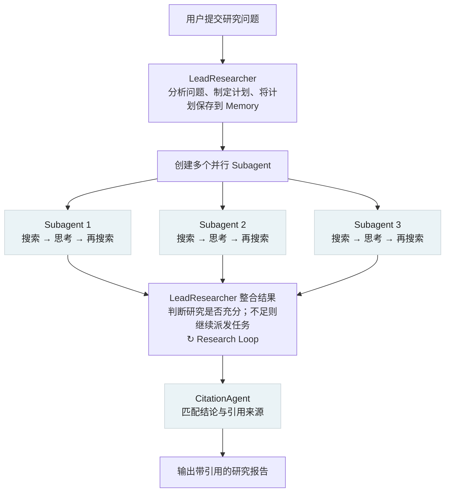

## Multi-Agent Systems（多智能体系统）

### 1. 为什么需要 Multi-Agent？

单 :concept[Agent]{id="ai-agent"} 存在两个主要限制: 
- **:concept[上下文]{id="llm-context"}容量有限:** 大量搜索结果会占据 Context Window，增加信息管理难度。
- **串行执行效率低:** 需要依次调查多个独立方向，研究时间可能很长。

==**Multi-Agent:** 采用 **多个 Agent 协作** 的方式，将复杂研究任务拆成可以并行执行的子任务。==

每个 Subagent 都拥有独立的 Context Window，可以独立探索大量信息，再将最重要的内容压缩后返回 Lead Agent。

因此，Subagent 同时扮演两个角色: 
1. **独立研究者:** 负责特定研究方向。
2. **信息过滤器:** 筛选重要内容，减少 Lead Agent 的上下文负担。

不过 Multi-Agent 虽然相对 Single-Agent 可以带来显著的能力提升，但是 Token 用量也会增加。因此更适合高价值、可并行拆分、需要大量信息检索的复杂任务。

### 2. Multi-Agent Research 的系统架构

| 组件 | 职责 |
| --- | --- |
| LeadResearcher | 规划、任务拆分、调用 Subagent、整合结果 |
| Subagent | 独立搜索、分析来源、返回研究发现 |
| CitationAgent | 检查报告中的结论并定位对应引用 |

- 第一，Lead Agent 会将研究计划保存到外部 Memory，将关键计划持久化，避免上下文截断后丢失研究方向。
- 第二，Subagent 并非只调用一次搜索 API，而是能够分析搜索结果、识别信息缺口，并继续检索。
- 第三，研究结束后，系统会交给 CitationAgent 定位支持报告结论的具体来源，而不是只依赖研究 Agent 在生成文本时顺带处理引用。

### 3. 让多个 Agent 有效协作

#### a. 观察 Agent 的真实执行过程。

仅阅读 Prompt 很难知道 Agent 实际会怎么执行。

#### b. 明确每个 subagent 的任务分工。

| 要素 | 说明 |
| --- | --- |
| Objective | 具体要调查什么 |
| Output Format | 应当返回怎样的结果 |
| Tools / Sources | 使用哪些工具和信息来源 |
| Boundaries | 任务范围和不需要调查的内容 |

#### c. 根据任务复杂度分配资源。

| 任务复杂度 | Agent 数量 | 工具调用预算 |
| --- | --- | --- |
| 简单事实查询 | 1 | 3–10 次 |
| 直接比较任务 | 2–4 个 Subagent | 每个 10–15 次 |
| 复杂研究 | 可能超过 10 个 Subagent | 依据职责分配 |

#### d. 正确选择工具。

随着 :concept[MCP]{id="mcp"} 接入的工具增加，Agent 更容易因为 Tool Description 不清晰而选择错误工具。

- 先检查可用工具及其用途。
- 根据用户目标匹配合适工具。
- 优先使用针对任务设计的专用工具。
- 保证工具描述清晰，避免职责重叠。

可以使用专门的工具测试 Agent，自动尝试使用工具、发现错误，并改写工具描述。

#### e. 先广泛探索，再深入调查

研究初期不要直接使用非常狭窄的搜索条件。

正确策略是先了解整体信息分布，再逐步收窄问题。

#### f. 使用 Thinking 进行动态规划

Agent 不应一开始就固定全部搜索步骤，而应该根据中间结果动态修正计划。

#### g. 两级并行化

- Lead Agent 同时启动多个 Subagent。
- 每个 Subagent 又可以并行调用多个工具。

#### h. 优先使用启发式规则，而非死板流程

### 4. 评估 Multi-Agent 系统

#### a. 重点关注: 最终结果是否正确，完成任务的过程是否合理。

#### b. 从小规模测试开始

#### c. LLM-as-Judge

使用 LLM 作为评审，重点检查五个维度。

| 维度 | 评测问题 |
| --- | --- |
| Factual Accuracy | 事实是否正确？ |
| Citation Accuracy | 引用是否真正支持对应结论？ |
| Completeness | 是否覆盖用户要求的全部方面？ |
| Source Quality | 是否优先采用可靠的一手来源？ |
| Tool Efficiency | 是否以合理的工具调用成本完成任务？ |

#### d. 引入必要的 Human Evaluation

### 5. Production Reliability

#### a. 支持故障恢复

- **Checkpoint:** 定期保存执行状态。
- **Retry:** 对适合重试的失败进行重试。
- **Resume:** 尽可能从故障位置恢复执行。
- **Adaptive Recovery:** 把工具失败情况告诉模型，让模型调整执行策略。

#### b. 完整追踪执行路径、错误原因，分析高层级的 Agent 行为模式

#### c. Rainbow Deployment

让新旧版本暂时并存，再逐步迁移流量，避免影响正在执行的任务。

#### d. 同步执行与异步执行的取舍

## 参考资料

- [How we built our multi-agent research system](https://www.anthropic.com/engineering/multi-agent-research-system)
- [[agent-learning-04]]
